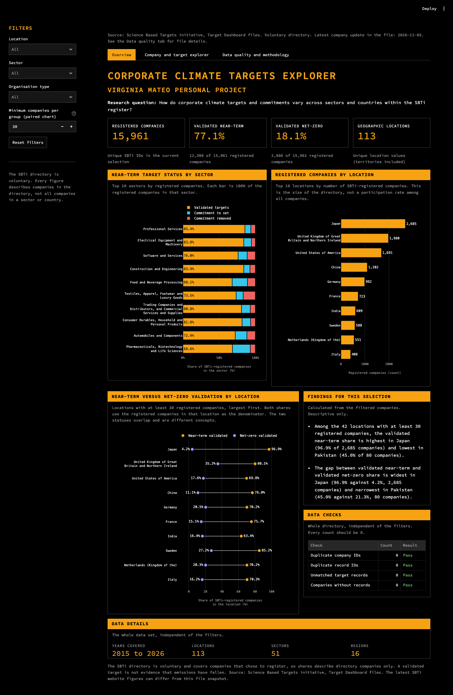

# Corporate Climate Targets Explorer

An interactive Streamlit dashboard and Python data pipeline that explore how climate commitments and validated near-term and net-zero targets vary across sectors and locations among companies in the Science Based Targets initiative (SBTi) directory.

Research question: how do corporate climate targets and commitments vary across sectors and countries within the SBTi register?



## Overview

SBTi publishes two Excel files, one with a row per registered company and one with a row per target or commitment. I joined them on the SBTi ID, checked the one-to-many relationship, and built a dashboard that answers three questions: which sectors and locations have the most registered companies, how near-term status differs between groups, and how the share of companies with a validated net-zero target compares with the share with a validated near-term target.

Target setting with SBTi is voluntary, so every share in this project describes companies in the directory. It does not describe all companies in a sector or country, and a validated target does not show that emissions have fallen.

## Data at a glance

| | Companies file | Targets file |
|---|---|---|
| Source file and worksheet | `companies-excel.xlsx`, `Data` | `targets-excel.xlsx`, `WebsiteData` |
| Row grain | One registered company | One target or commitment record |
| Raw rows | 15,961 | 41,593 |
| Processed rows | 15,961 | 41,593 |
| Named columns in the source | 22 (the worksheet has 26, four trailing columns are empty) | 28 |
| Processed columns | 23 | 32 |
| Distinct keys | 15,961 `sbti_id` | 41,593 `row_entry_id` |
| Records without a matching company | | 0 |
| Companies without a record | 0 | |

| Coverage | Value |
|---|---|
| Locations | 113 (countries, territories and other geographic designations, not only sovereign states) |
| Sectors | 51 |
| Regions | 16 |
| Organisation types | Corporate 8,870, SME 6,772, Financial Institution 319 |
| Years covered by the data | 2015 to 2026 |
| Latest company `date_updated` in the files | 2026-11-05 |

Company status in the files, as a share of 15,961 registered companies:

| Status | Near-term | Net-zero |
|---|---:|---:|
| Validated targets | 12,308 (77.1%) | 2,886 (18.1%) |
| Commitment to set targets | 2,066 (12.9%) | 946 (5.9%) |
| Commitment removed | 1,587 (9.9%) | 1,295 (8.1%) |
| Not recorded (blank) | 0 | 10,834 (67.9%) |

The targets file holds 29,513 Target records and 12,080 Commitment records. A company has a median of 2 records and at most 25. The processed tables include extra `_raw` columns that keep the original value of every transformed column.

## Exploratory data analysis

- The company table is the source for every company count and share. Target records are selected by the IDs of the filtered companies and never used to count companies.
- The `status` column of the targets file has different meaning from the company statuses. For example, 29,453 target records have the value `Other`, so I did not use that column for any company share.
- A blank `net_zero_status` is shown as Not recorded. It is kept separate from Commitment removed.
- Of the 29,513 Target records, 65 have no recorded target year. They are excluded from the target year chart and counted in its note.

## Key findings

1. Japan (2,685), the United Kingdom (1,980) and the United States (1,691) together account for 6,356 of the 15,961 registered companies (39.8%).
2. 77.1% of registered companies have a validated near-term target and 18.1% have a validated net-zero target. For 67.9% no net-zero status is recorded.
3. The gap between the two shares differs by location. Japan has 96.9% validated near-term and 4.2% validated net-zero (2,685 companies). The United Kingdom has 80.1% and 35.2% (1,980 companies). These are descriptive shares of directory companies, and I did not test what explains the difference.
4. Among the 42 locations with at least 30 registered companies, the validated near-term share runs from 45.0% (Pakistan, 80 companies) to 96.9% (Japan, 2,685 companies).

## Method

1. Read both workbooks with `openpyxl` instead of the pandas Excel reader. The pandas reader turns the text `NA` and empty cells into missing values, and the files use both with different meaning.
2. Convert SBTi IDs from Excel numbers to exact eight-digit text. Values that are missing, non-integral or outside the `4xxxxxxx` pattern are rejected.
3. Strip leading and trailing whitespace from identifier and category columns only. This affected 5 company names in the targets file (one company, HOKKAN HOLDINGS LIMITED, with a full-width trailing space).
4. Convert Excel dates to ISO dates, convert whole-number years such as `2030.0` to `2030` (41 target years and 41 base years) while keeping `FY` and `CY` forms, and convert numeric scopes `1.0`, `2.0`, `3.0` to `1`, `2`, `3` (782 values). Multi-scope values such as `1+2` are unchanged.
5. Log every transformation with the number of values changed. The log is written to `reports/data_quality.json` and shown in the dashboard.
6. Check that company IDs and target record IDs are unique, that every target record links to a company, that every company has at least one record, that each record ID ends with its company ID, and that sector, location and region agree between the two tables.
7. Write `data/processed/companies.csv` and `data/processed/targets.csv`. The build is deterministic and stops without writing if a check fails.

## Dashboard

The sidebar filters by location, sector and organisation type. All three combine as an intersection and drive every card, chart, table, finding and export.

- Overview: four cards (registered companies, validated near-term, validated net-zero, locations) with numerator and denominator, near-term status by the ten largest sectors, the ten largest locations by registered companies, a paired-dot comparison of the two validation shares for locations above an adjustable minimum size, and findings calculated from the current selection.
- Company and target explorer: search by company name or SBTi ID, the linked target and commitment records of the selected company, searchable company and record tables, CSV downloads of exactly the rows displayed, and optional charts of target type, scope and year for Target records.
- Data quality and methodology: raw and processed row and column counts, integrity checks, the transformation log, missing values, source file hashes, the latest update date, a glossary and the result of the last test run.

## Run locally (environment already set up)

If the virtual environment exists, the packages are installed and the processed data has been built, run this from the repository root:

```bash
source .venv/bin/activate
python -m streamlit run app.py
```

Streamlit prints a local address, usually http://localhost:8501.

## Run locally (first-time setup)

The SBTi files are not included in this repository (see Data limitations and sources). From the repository root:

```bash
python -m venv .venv
source .venv/bin/activate
pip install -r requirements.txt
pip install -e ".[dev]"

cd data/raw
curl -O https://files.sciencebasedtargets.org/production/files/companies-excel.xlsx
curl -O https://files.sciencebasedtargets.org/production/files/targets-excel.xlsx
curl -O https://files.sciencebasedtargets.org/production/files/Alpha-Dashboard-Data-Dictionary.xlsx
cd ../..

python scripts/inspect_sources.py
python scripts/build_data.py
python -m streamlit run app.py
```

SBTi refreshes these files at the same addresses, so a later download can give different counts. The snapshot tests then fail and ask for the differences to be reviewed (see `tests/reference_values/README.md`).

## Testing

```bash
python -m pytest -q
```

The default run executed 133 tests, all passed. They are in [tests/](tests/). Expected values come from `tests/independent_recount.py`, a separate script that counts directly from the workbooks and does not use the project code. The tests cover the source files, the cleaning rules, the company and target relationship, every location and sector count, filters, empty selections, exports, the chart contents and the Streamlit app through `AppTest`.

Five browser tests use Playwright and run on demand:

```bash
python -m playwright install chromium
python -m pytest -m browser
```

They check the default cards, a chart tooltip, a location filter, an empty selection with reset, a CSV download and the absence of horizontal overflow in a narrow window.

CI runs lint and the tests that do not need the workbooks.

## Data limitations and sources

- The directory is voluntary. Shares describe registered companies only.
- A validated target is a status assigned by SBTi. It does not show that emissions have fallen or that a target was met.
- The SBTi website is updated continuously, so its figures can differ from the file snapshot used here.
- `location` contains countries, territories and other designations, so a location is not always a sovereign state.
- The SBTi website terms allow storing content for research and non-commercial use with attribution. They do not address redistributing datasets, so I did not commit the original or the cleaned files and did not publish a hosted app that exposes company records. Details are in [data/README.md](data/README.md).

Source: Science Based Targets initiative, Target Dashboard, https://sciencebasedtargets.org/target-dashboard
